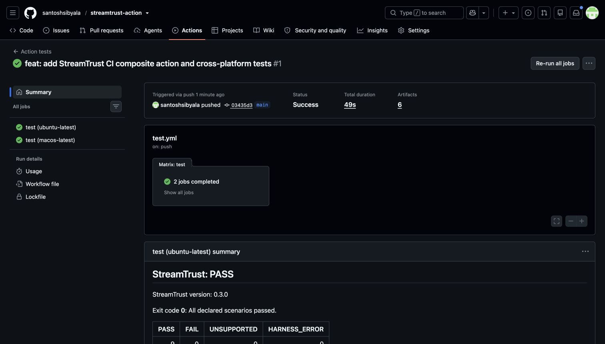

# StreamTrust GitHub Action

Run StreamTrust checks against your streaming application's trusted adapter, see results in the job summary, and retain diagnostic reports. This composite action wraps the published CLI without changing its checks or report format.

**Action version: v1.0.0.** Use `@v1` for compatible Action updates or pin `@v1.0.0` for this release. The default StreamTrust CLI version is pinned independently to `0.3.0`.

## Quick start

After checking out your repository, installing your app/adapter dependencies and starting any required test services, add:

```yaml
- uses: santoshsibyala/streamtrust-action@v1
  with:
    adapter: ./streamtrust/adapter.mjs
    node-version: '22'
    artifact-name: streamtrust-report
```

The default CLI pin is **0.3.0**. You need an adapter that maps your application's UI/API and authoritative saved state. `npx --yes streamtrust@0.3.0 init` generates a runnable HTTP/SSE teaching example; it initially tests a bundled demo. See the [StreamTrust adapter guide](https://github.com/santoshsibyala/streamtrust#connect-your-application). LibreChat and Vercel AI SDK presets need their own dependencies/setup from the package guides; the Action does not install those for you.

## Full workflow

Adapted from StreamTrust's existing CI example. Replace `start:test`, port 3000, `/health` and any adapter-specific environment variables with your app's actual test setup. Add builds, disposable database setup, migrations and browser installation before the start step where required.

```yaml
name: Streaming application verification
on: [push, pull_request]
permissions:
  contents: read
jobs:
  verify:
    runs-on: ubuntu-latest
    timeout-minutes: 15
    steps:
      - uses: actions/checkout@3d3c42e5aac5ba805825da76410c181273ba90b1 # v7.0.1
        with:
          persist-credentials: false
      - uses: actions/setup-node@949feb2413d6458794dcd2491c4babbbce0c15c1 # v7.1.0
        with:
          node-version: '22'
          package-manager-cache: false
      - run: npm ci
      - name: Start test app and wait for readiness
        shell: bash
        run: |
          npm run start:test > app.log 2>&1 &
          app_pid=$!
          for attempt in {1..30}; do
            if ! kill -0 "$app_pid" 2>/dev/null; then
              echo 'Test app exited before readiness.'
              exit 1
            fi
            if curl --fail --silent --max-time 2 http://localhost:3000/health; then
              exit 0
            fi
            sleep 2
          done
          echo 'Test app did not become ready in time.'
          exit 1
      - name: Verify streaming behavior
        id: streamtrust
        uses: santoshsibyala/streamtrust-action@v1
        with:
          adapter: ./streamtrust/adapter.mjs
          version: '0.3.0'
          output: reports/streamtrust
          repetitions: '3'
          timeout-ms: '300000'
          artifact-name: streamtrust-report
          fail-on: failures
        env:
          STREAMTRUST_BASE_URL: http://localhost:3000
```

For a monorepo, set `working-directory: apps/chat`; both `adapter` and `output` resolve relative to it. Set up that app's dependencies and services first. For concurrent/matrix invocations use distinct output directories and artifact names. On persistent runners clean old reports explicitly before the job, or use a unique output directory: the Action refuses a nonempty directory to prevent stale evidence from looking like a new result.

## Inputs

| Input | Default | Meaning |
|---|---|---|
| `adapter` | Required | Trusted adapter path, relative to working-directory; spaces and shell metacharacters remain literal filename characters. |
| `version` | `0.3.0` | Exact npm SemVer, including prereleases. Ranges, URLs and arbitrary tags are rejected. Explicit `latest` is allowed as an opt-in to a nonreproducible version; prefer an exact pin. |
| `working-directory` | `.` | Existing directory, relative to the workflow workspace. |
| `output` | `reports/streamtrust` | New or empty directory inside working-directory; no symlink components, line breaks or artifact glob characters. |
| `repetitions` | `3` | Integer 1-1000. |
| `timeout-ms` | `300000` | CLI deadline, integer 100-86400000, including adapter setup and cleanup; npm installation time is additional. Use a job timeout too. |
| `node-version` | Empty | If set, use pinned setup-node. Otherwise use Node on PATH; Node below 22 is rejected. |
| `upload-report` | `true` | Literal `true` or `false`. Upload after verifier failure too. |
| `artifact-name` | `streamtrust-report` | 1-128 letters, digits, dots, underscores or hyphens; first character letter/digit. Unique per invocation in a run. |
| `fail-on` | `failures` | `failures`: fail on 1/2; `errors`: fail only on 2; `never`: report only. |

## Outputs and exit codes

| Output | Meaning |
|---|---|
| `exit-code` | Effective verifier result: `0`, `1`, or `2`, independent of fail-on. |
| `report-path` | Absolute path to validated report.json; empty if missing/invalid or validation prevented execution. |
| `pass-count` | Number of PASS scenario executions. |
| `fail-count` | Number of FAIL scenario executions. |
| `unsupported-count` | Number of UNSUPPORTED scenario executions. |
| `harness-error-count` | Number of HARNESS_ERROR scenario executions; suite-level setup/cleanup errors are separate. |

Counts come from report.json, defaulting absent categories to zero for a valid report. They are **scenario repetitions, not individual assertions**. If no valid report exists, counts are empty, not zero.

| Exit | Meaning |
|---|---|
| 0 | Every declared scenario passed. |
| 1 | Failed assertions or explicitly unsupported scenarios. |
| 2 | Setup, timeout, harness/cleanup error, invalid input, npm execution failure, or missing/invalid/inconsistent report. |

`fail-on` changes the final verification gate only. It does not suppress failures from GitHub infrastructure, setup-node, artifact uploads, cancellation or missing tooling. An invalid `fail-on` fails closed. A cancelled job may stop before outputs or uploads are produced. Use step-level `continue-on-error: true` only if you also intend to tolerate those operational failures.

## Reports and summary

The CLI writes `report.json`, `junit.xml`, `report.md` and `index.html`. The artifact contains the report directory's non-hidden files and is retained for seven days. Adapter-created evidence files may also be included. Upload is skipped if input validation fails; if npm fails before producing reports, there may be nothing to upload. Malformed report files remain available for diagnosis when generated in this invocation.

The job summary shows the CLI version, exit-code meaning, counts and a scenario/repetition/status table (up to 500 rows). Scenario text is escaped. Raw evidence, metadata, individual check names and raw suite errors are omitted. The full report supplies those details.



[View the real hosted run and complete summaries](https://github.com/santoshsibyala/streamtrust-action/actions/runs/42166185853).

## Security and compatibility

Adapters execute **trusted local code from your repository**, with the job's filesystem, environment and network permissions. Review adapters and dependencies; use disposable test data and minimal job permissions. Do not execute untrusted fork code in a privileged workflow. No secret is needed by the Action. Custom adapters may need credentials; never put secrets or customer conversations into uploaded evidence. The Action does not redact artifact files or CLI logs.

Inputs reach the wrapper through environment variables. The wrapper invokes `npx` with an argument array and `shell: false`, disables npm install scripts, and never prints the environment. The summary has no dependencies or telemetry. The wrapper performs no independent network requests: npm retrieves the requested package, optional setup-node can retrieve Node, and upload-artifact sends reports to GitHub. Adapters can make their own application requests. Set `upload-report: 'false'` and preinstall Node to avoid the optional setup/upload operations.

All third-party action references are pinned to full commit SHAs. The intended hosted targets are `ubuntu-latest` and `macos-latest`. Local and hosted validation status is recorded in [TEST-RESULTS.md](TEST-RESULTS.md). Windows and GitHub Enterprise Server are not validated; the artifact action targets GitHub.com. Self-hosted runners must support the pinned actions' Node 24 runtime as well as Node 22+ for StreamTrust.

## Development

No package install is needed for unit tests:

```sh
node --test test/*.test.mjs
node test/integration.mjs
```

The integration script downloads/runs published `streamtrust@0.3.0` in an isolated temporary consumer. GitHub workflows additionally exercise composite step wiring and artifact delivery. See [RELEASING.md](RELEASING.md) for exact hosted test and publishing steps.
